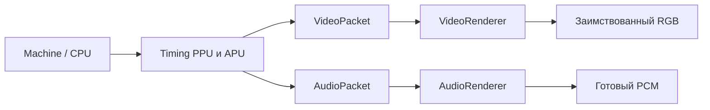

# Ядро Bitvyr NES P4

Собственные C++17 CPU/PPU/APU и mapper. Ядро не включает ESP-IDF, FreeRTOS,
Board, SD/ZIP, Bluetooth и драйверы. Единственный продуктовый профиль задан
в `cmake/CoreProfile.cmake`:81 PUBLIC определения согласуют headers/ABI,
21 PRIVATE выбирают проверенные реализации. Это не набор пользовательских опытов.

Worker единолично владеет первичной Machine. Main получает опубликованный
пакет/снимок либо читает после настоящего join; тайм-аут не передаёт владение.
ROM/backing заимствованы до завершения всех пользователей. Lease, generation,
epoch, slot, sequence, region и временной срез проверяются до reuse.
RGB остаётся неизменным до подтверждения чтения источника PPA; это не LCD VSYNC.

Quiet/grant/span ускоряют только доказанные интервалы. MMIO, IRQ/NMI, DMA/DMC,
mapper/latch и наблюдаемые границы сохраняются; отказ оставляет исходный путь.
Новых ROM/кадровых копий, задач и heap-выделений в горячем цикле нет.
Ошибки backing/capacity/ownership не разрешают повторное исполнение изменённого префикса.
`resetCpuReadWindow()` завершает отложенные чтения и обнуляет CPU-read budget на явной границе владельца.

Проверка: `tests/host` собирает продуктовый Core и отдельный scalar-reference
из тех же исходников. Второй target существует только для независимых bus fixtures,
не включается продуктовым option и не копирует ядро. Target ABI/стек/HP-память,
SD, звук, управление и moving FPS требуют отдельной проверки платы.
