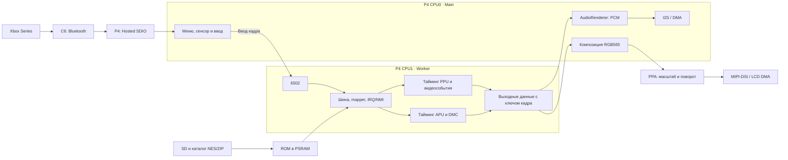
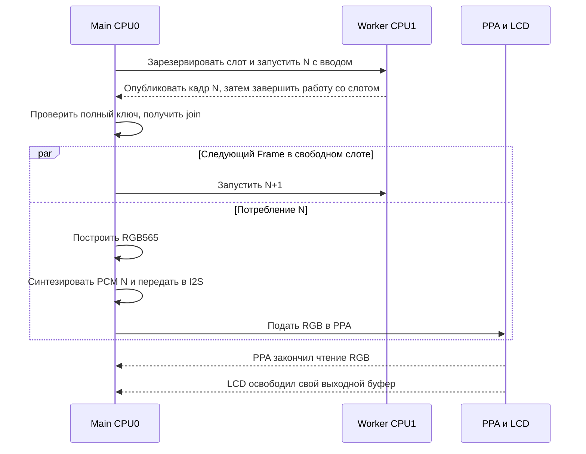
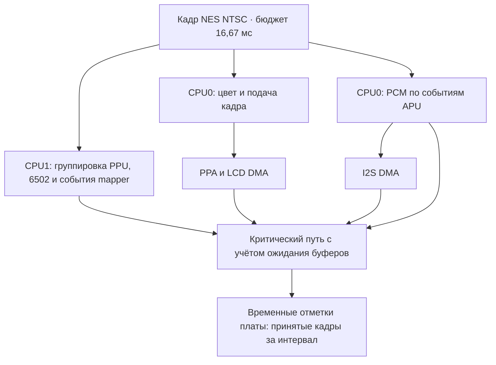

# Архитектура P4

`NesApp` управляет библиотекой, меню и сеансом. Единственный владелец изменяемой `Machine` — Worker на CPU1. Ядро C++17 получает вход кадра и ROM, исполняет 6502 и сохраняет доступный игре порядок PPU, APU, IRQ/NMI и DMA.

## Владение кадром

Кадры всех поддерживаемых картриджей передаются через Frame с двумя слотами. Полный ключ связывает слот, поколение сеанса, ROM и номер кадра. Main получает результат после release-публикации и проверки завершения Worker. Отсутствие подтверждения удерживает заимствованные ресурсы до настоящего завершения.

Main рассчитывает PCM из пакета N. Состояние фильтров и курсор PCM сохраняются между соседними кадрами. При смене игры Main дожидается освобождения видеослотов и звуковых пакетов.

## Откуда берётся скорость

Группировка PPU и исполнение чистых отрезков 6502 сокращают работу до следующей наблюдаемой границы. К этой границе относятся записи регистров, IRQ/NMI, DMA и чтения со стороны гостевого CPU. Горячие объекты размещаются в HP SRAM. Короткие циклы CPU, чистые интервалы шины, пакетная обработка тайлов и прямое чтение разрешённых банков уменьшают число вызовов внутри кадра. CPU0 синтезирует PCM и цвет предыдущего кадра параллельно с CPU1. Для FM VRC7 производные параметры пересчитываются при записи регистров.

В ручной записи TMNT II дал **54,546 FPS** в среднем. CPU1 тратил в среднем около **16,9 мс** на кадр. В сыгранных сценах Castlevania III и Just Breed EN CPU1 занимал **28,7–29,9 мс**, что превышает бюджет кадра. Времена параллельных стадий перекрываются. FPS по принятым кадрам и частота развёртки LCD — отдельные величины. Полные числа и границы замеров приведены в [результатах](04-results.md).

## Пакеты

| Папка | Ответственность |
|---|---|
| `app/nes/core` | 6502, шина, тайминг PPU/APU, mapper, выходные события |
| `app/nes/runtime` | Слоты, подготовка и показ кадра, завершение сеанса |
| `app/nes/storage`, `compression` | Индекс SD, валидация ROM и распаковка ZIP |
| `app/nes/graphics`, `input`, `settings` | Меню, ввод, хранилище настроек |
| `app/nes/console`, `main` | UART и запуск приложения |
| `components/board_support` | PPA, LCD, I2S, сенсор, SD и Hosted/Bluetooth |
