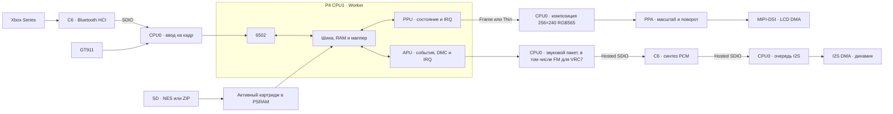
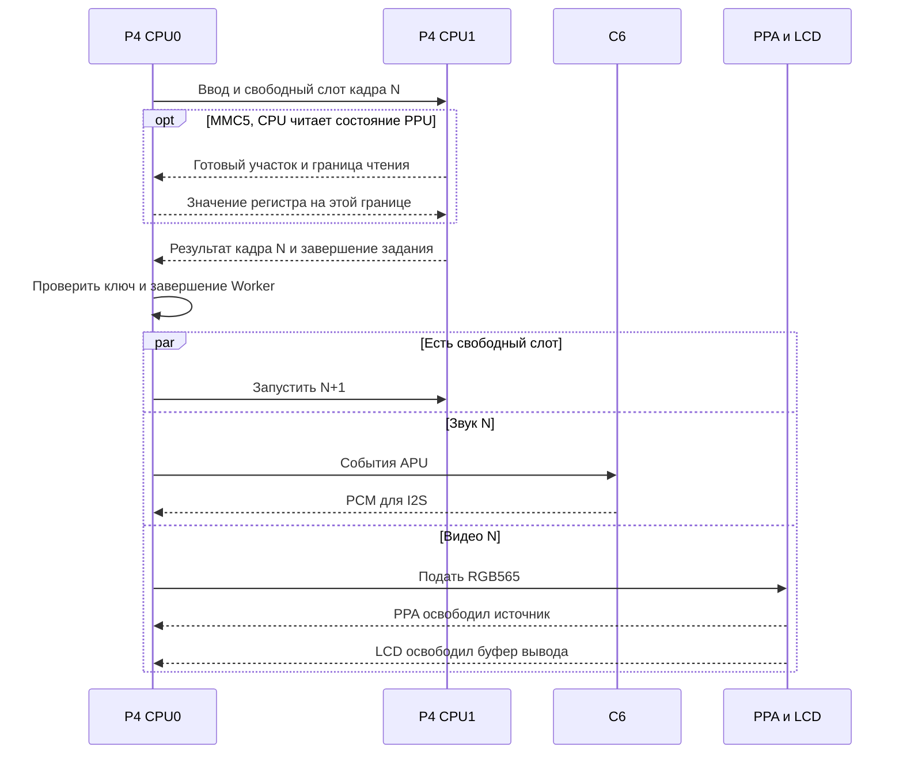
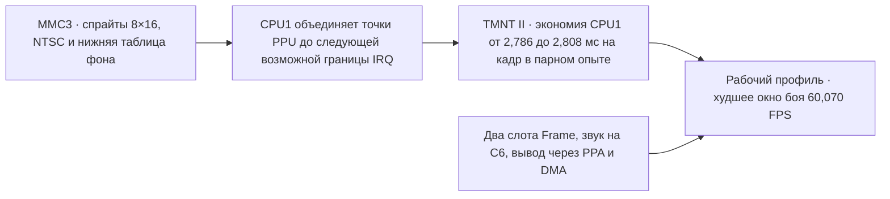

# Архитектура P4+C6

Worker на CPU1 — единственный владелец изменяемого состояния `Machine`. Он исполняет 6502, рассчитывает тайминг PPU/APU, прерывания, DMA гостя и переключения банков картриджа. CPU0 обслуживает ввод и библиотеку, собирает изображение RGB565 и управляет выводом. C6 рассчитывает PCM 48 кГц и обслуживает Bluetooth.

Обычный картридж использует `Frame` с двумя слотами. Для MMC5 CPU1 публикует готовые участки PPU через `Thin/Coupled`. CPU0 последовательно восстанавливает цвет и при наблюдаемом чтении возвращает запрошенный байт CPU1. Ключ результата включает сеанс, ROM, слот и номер кадра. У запроса к C6 также есть эпоха транспорта и идентификатор.

## Откуда берётся скорость

Ядро ограничивает группу точек PPU возможным фронтом IRQ и началом строки 240. При чтении или записи, доступных гостю, оно доводит PPU до нужного такта. CPU0 может обрабатывать цвет и PCM предыдущего кадра, пока CPU1 исполняет следующий. PPA и LCD освобождают свои буферы независимо. На MMC5 длительность кадра также зависит от обмена между CPU1 и CPU0.

Бюджет 60 FPS — 16,67 мс на кадр. Средний FPS сцены равен числу кадров, поданных драйверу, делённому на время платы. Три окна по 120 кадров показывают разброс внутри маршрута. [Сцены и результаты выпуска](04-results.md)

| Путь | Ответственность |
|---|---|
| `app/nes/core` | Исполнение 6502, память картриджа, PPU и APU |
| `app/nes/runtime` | Слоты Frame, обмен Coupled и завершение заданий |
| `app/nes/audio/c6`, `coprocessor/c6_audio` | Протокол P4, транспорт и программа C6 |
| `app/nes/storage`, `compression` | Каталог и чтение ROM с SD |
| `app/nes/graphics`, `input`, `settings` | Меню, управление и настройки NVS |
| `components/board_support` | Экран, SD, сенсор, Bluetooth и I2S |
