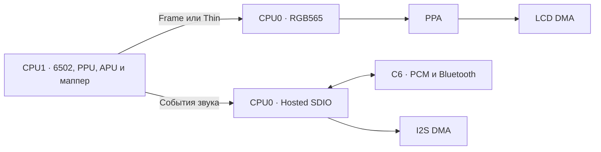

# Архитектура экспериментальной редакции P4+C6

Рабочий профиль `0.1-dev` использует ядро Beta 0.1. CPU1 исполняет игру, CPU0 строит цвет и управляет оборудованием, а C6 синтезирует PCM и обслуживает Xbox по Bluetooth.

В MMC3 ядро группирует точки PPU до ближайшей возможной границы IRQ. На MMC5 CPU1 передаёт готовые участки PPU через Coupled. Время кадра зависит от завершения вычислений и доступности очередей видео и звука. [Подробная схема и путь кадра](../../beta_0_1/docs/02-architecture.md) · [Измерения](04-results.md)
