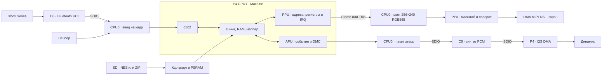
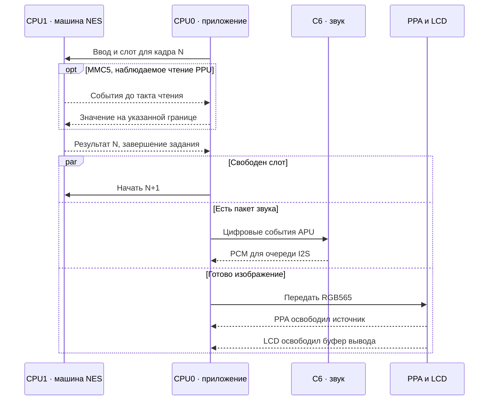

# Как Bitvyr исполняет кадр NES

На CPU1 работает задача Worker. Она единолично меняет состояние эмулируемой машины `Machine` и задаёт порядок команд 6502, обращений к памяти, событий PPU/APU, DMA и прерываний. CPU0 подаёт ввод, собирает цвет и обслуживает очереди вывода. Гостевые устройства используют общий счётчик тактов NES.

**Обычные мапперы.** Конвейер `Frame` хранит два слота, поэтому CPU1 может начать следующий кадр, пока CPU0 обрабатывает зафиксированный результат предыдущего. У мапперов 7 и 71 в режиме NTSC готовый кадр можно раньше передать PPA. CPU0 проверяет поколение, номер кадра и владельца буфера. Каждому устройству принадлежит свой интервал использования памяти.

**MMC5.** Изображение зависит от переключений банков CHR, атрибутов, чтений PPU и прерываний внутри строки. CPU1 передаёт CPU0 группы событий через кольцо `ThinBridge`. Когда следующий результат виден гостевой программе, чтение синхронизирует обе стороны. CPU0 хранит строку индексов цвета во внутренней SRAM и восстанавливает RGB565 для дисплея.

## Что экономит время кадра

| Участок | Как сокращается работа |
| --- | --- |
| CPU, PPU и маппер | Ядро объединяет такты до ближайшего события, которое способно поменять наблюдаемый результат. Например, у MMC3 пределом служит возможный фронт IRQ и переход на строку 240. В парном опыте на TMNT II это освободило 2,786–2,808 мс CPU1 на кадр. |
| MMC5 | Пока условия участка подтверждены, ядро продвигает CPU и PPU сразу до его границы. Ожидание нулевого статуса сокращается только при выполнении проверки на эквивалентность. Перед наблюдаемым обращением цифровое состояние и прерывания доводятся до нужного такта. |
| Видео и звук | CPU0 работает с уже опубликованными данными. Воспроизведение звука на C6 и вывод через PPA и DMA пересекаются во времени с исполнением следующего кадра на CPU1. У маппера 85 CPU0 также подготавливает данные FM-каналов. |

Бюджет 60 FPS составляет 16,67 мс на поданный кадр. Длительности участков на разных ядрах накладываются. Итог считают по времени платы между подачами. [Окна и скорость по каждой игре](04-results.md)

| Код | Ответственность |
| --- | --- |
| `app/nes/core` | 6502, шина, мапперы, PPU и цифровая APU на переносимом C++17 |
| `app/nes/runtime` | Задачи CPU0/CPU1, владение слотами `Frame`, обмен `Coupled`, запуск и завершение игры |
| `app/nes/audio/c6`, `coprocessor/c6_audio` | Стороны P4 и C6 протокола аудиопакетов |
| `app/nes/storage`, `compression`, `graphics`, `input`, `settings` | Библиотека ROM, распаковка, меню, управление и настройки |
| `components/board_support` | Драйверы платы для SD, сенсора, Bluetooth, PPA, экрана и I2S |
