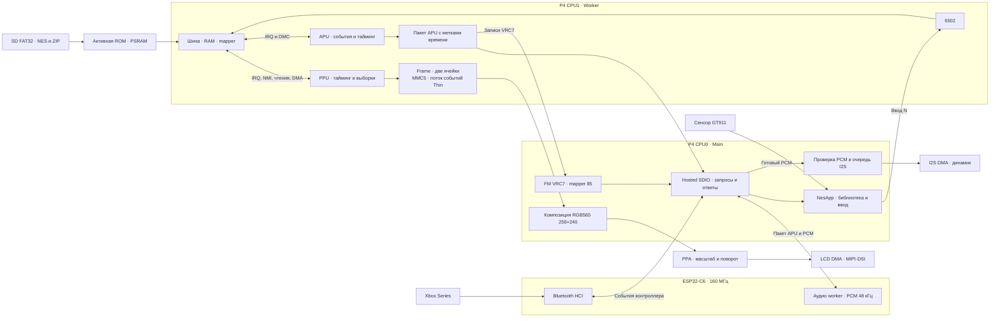
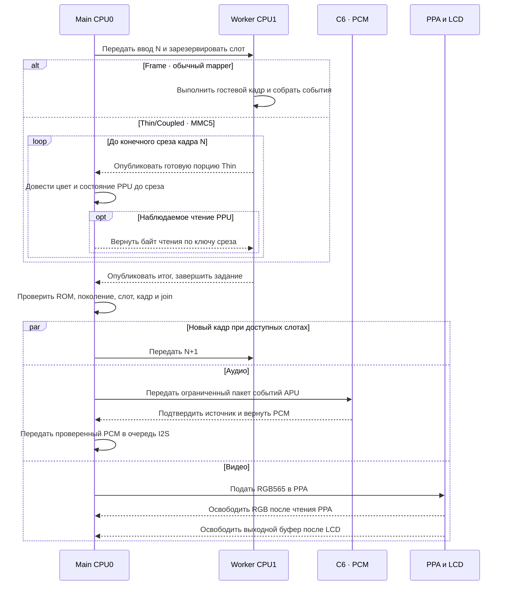
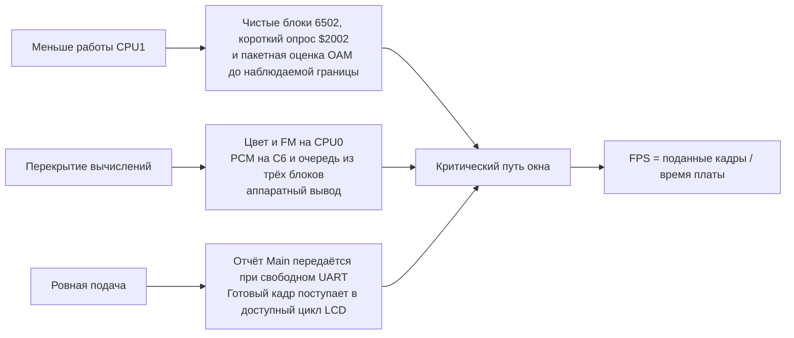
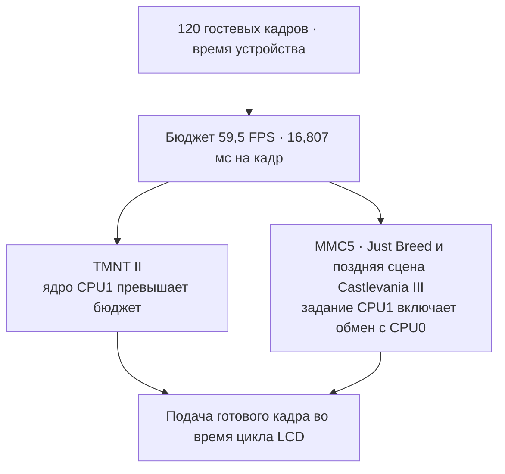

# Архитектура P4+C6

Worker на P4 CPU1 владеет `Machine` и исполняет гостевой 6502. Шина связывает
CPU с памятью, mapper, PPU и APU. CPU0 владеет меню, вводом и оборудованием
платы. C6 синтезирует PCM и обслуживает Bluetooth, а события, видимые гостю
через APU, DMC, IRQ и DMA, рассчитывает P4.

## Как движется один кадр

Frame держит два слота. Для MMC5 обмен Thin ограничен кольцом и подтверждениями
срезов. Публикация порции, чтение PPU и итоговое завершение относятся к разным
границам. CPU0 восстанавливает цвет в гостевом порядке и возвращает только
запрошенный байт с тем же ключом. Синхронизация задерживает CPU1 там, где 6502
действительно наблюдает состояние PPU.

Короткий блок CPU1 может писать напрямую в текущий банк WRAM MMC5 по адресам
$6000–$7FFF, если защита записи открыта и внутри блока сохраняется тот же банк.
Шинные операции на наблюдаемых границах выполняются обычным путём.
Контекст C6 дополнительно проверяет эпоху транспорта и идентификатор запроса.
Смена ROM освобождает ресурсы после подтверждений Worker, C6 и дисплея.

## За счёт чего получается текущий FPS

При чтении STATUS ядро проверяет границы видимой строки, Sprite0 и OAM.
При доказанном отсутствии других растровых изменений CPU1 может довести
только оценку OAM до точки чтения. Остальные точки PPU продолжают обрабатываться
пакетами. Это уменьшает число команд видеопакета среди частых чтений STATUS.

Отложенные отчёты захватывают мьютекс самого stdout без ожидания и освобождают
тот же мьютекс. Это сохраняет порядок UART-строк и даёт Main вернуть базовый
приоритет между операциями.
Резерв во Flash после кадровой функции сохраняет измеренные адреса горячих
функций ядра при обычной сборке ESP-IDF.

В NTSC бюджет 60 FPS — примерно 16,67 мс на кадр. CPU1 и CPU0 перекрываются,
пока доступна память слотов. PPA и DMA продолжают работу после подачи кадра.
При DPI 30 МГц и полном поле 576 × 866 цикл LCD занимает около 16,627 мс.
Такой период даёт 60,142 FPS при своевременной подаче каждого кадра.
Очередь из трёх блоков PCM использует дополнительные 4 КиБ PSRAM. Она даёт Main принять блок C6 и продолжить кадр при задержке I2S, сохраняя порядок и задержку вывода в один или два гостевых кадра.

Время CPU1, CPU0 и C6 частично перекрывается. Для анализа просадки
сопоставляются время задания Worker и интервалы между принятием и подачей
кадров. Внутренние этапы одного задания входят в его общее время.

В опубликованном каталоге все три окна попали в целевой диапазон у **23 из
26 сцен**. TMNT II в том же каталоге дал минимум **53,859 FPS**. Дополнительная
сцена Castlevania III дала **57,932 FPS** в худшем окне. [Замеры и условия](04-results.md)

| Пакет | Ответственность |
|---|---|
| `app/nes/core` | 6502, шина, mapper, PPU/APU и события |
| `app/nes/runtime` | Frame, Coupled, публикация, принятие и завершение |
| `app/nes/audio/c6` | Допуск, транспорт SDIO, запросы и PCM |
| `coprocessor/c6_audio` | Сборка и реализация worker C6 |
| `app/nes/storage`, `compression` | Каталог SD и распаковка ZIP |
| `app/nes/graphics`, `input`, `settings` | Меню, управление и настройки NVS |
| `app/nes/console`, `main` | UART и запуск приложения |
| `components/board_support` | PPA, LCD, I2S, сенсор, SD и Bluetooth |
